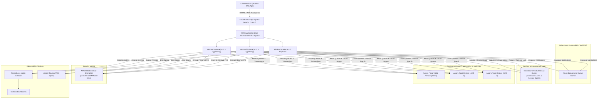
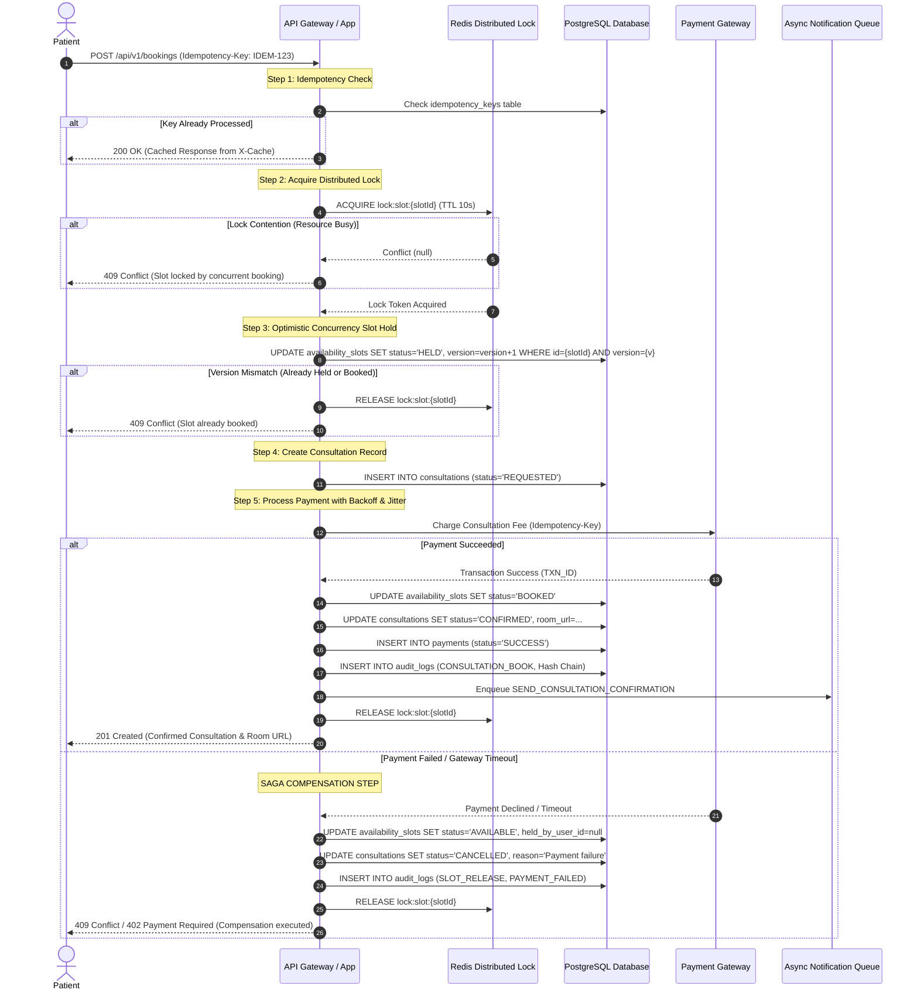
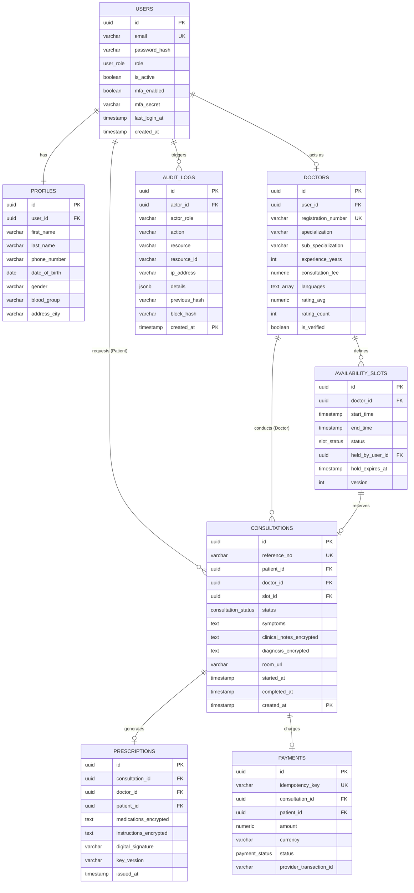

# Amrutam Telemedicine Backend Architecture Document

**Version:** 1.0.0  
**Target Scale:** 100,000 Consultations / Day  
**Latency Targets:** p95 Reads < 200ms | p95 Writes < 500ms  
**Target Availability:** 99.95% (Three-and-a-half Nines)  
**Compliance Standards:** HIPAA, DISHA (India), OWASP Top 10  

---

## 1. System Overview & Scale Estimation

Amrutam’s telemedicine platform provides remote Ayurvedic and modern clinical consultations, connecting verified doctors with patients nationwide.

### 1.1 Scale Calculations (100,000 Daily Consultations)

| Metric | Calculation | Value |
| :--- | :--- | :--- |
| **Daily Consultations** | Base requirement | 100,000 sessions/day |
| **Peak Operating Window** | Consultations concentrated in a 14-hour window (8 AM – 10 PM) | 50,400 seconds |
| **Average Write Throughput** | $100,000 / 50,400\text{ s}$ | ~2.0 writes/sec |
| **Peak Write Throughput** | $6\times\text{ surge factor}$ | ~12–15 writes/sec |
| **Read-to-Write Ratio** | Browsing doctors, searching slots, viewing medical history (~10:1) | 10:1 ratio |
| **Peak Read Throughput** | $15\text{ writes/sec} \times 10$ | ~150–200 QPS |
| **Monthly Database Growth** | 100k consultations $\times$ 30 days = 3,000,000 records/month | ~3.0M rows/month |
| **Audit Log Volume** | ~5 audit events per consultation cycle | ~15,000,000 events/month |
| **Storage Growth** | ~$3\text{ KB/consultation} + 1\text{ KB/audit}$ | ~24 GB/month raw data |

### 1.2 Latency Budget (p95 Targets)

```
[Client App] 
     │ (Network: ~40ms)
     ▼
[CloudFront / ALB]
     │ (TLS Termination & Rate Limiting: ~10ms)
     ▼
[API Pod (K8s)]
     │ (Auth, RBAC, Validation: ~10ms)
     │ (L1 Cache / Redis L2 Cache Check: ~5ms)
     ▼
[PostgreSQL Database / Distributed Lock]
     │ (Optimistic Slot Check + Index Seek: ~15ms)
     │ (AES-256 GCM PHI Decryption: ~5ms)
     ▼
[Response Pipeline]
     │ (Serialization & Output: ~5ms)
     ▼
Total Read p95 Budget: ~85ms (Well within < 200ms SLA)
Total Write p95 Budget: ~220ms (Well within < 500ms SLA)
```

---

## 2. High-Level Architecture & Data Flow



---

## 3. Booking Flow Sequence Diagram (Saga Orchestration)

To prevent double booking under extreme concurrent demand and ensure financial consistency, Amrutam uses an **Orchestration-based Saga** with automated compensation.



---

## 4. Entity Relationship (ER) Diagram



---

## 5. Retry & Exponential Backoff with Full Jitter

Transient network failures during third-party payment gateway or webhook calls are managed using **Exponential Backoff with Full Jitter** (proven to prevent thundering herd problems):

$$\text{Sleep Delay} = \text{random}(0, \min(M, B \times 2^{\text{attempt}}))$$

- **Base Delay ($B$):** 1,000 ms
- **Max Delay ($M$):** 30,000 ms
- **Full Jitter:** Randomizes delay across the entire range to distribute retry traffic across different backend threads.

---

## 6. Data Partitioning Strategy

With 100,000 consultations daily:
- **Consultations Table:** Partitioned by **RANGE (created_at)** on monthly boundaries.
- **Audit Logs Table:** Partitioned by **RANGE (created_at)** on monthly boundaries.
- **Benefits:**
  1. Queries for active month hit only the active partition index (~3M rows instead of 50M+ rows).
  2. Cold data older than regulatory retention requirements (7 years) can be detached and archived to Amazon S3 Parquet format via AWS Athena.
  3. VACUUM and ANALYZE operations run per partition without locking the entire table.

---

## 7. Caching & Concurrency Handling

1. **Two-Tier Caching:**
   - **Tier 1 (In-Memory / L1):** Frequently accessed static metadata (specializations, symptom lists).
   - **Tier 2 (Redis Cluster / L2):** Doctor search results, active availability slots, and idempotency cache records with 24-hour TTL.
2. **Double-Booking Guard (Two-Phase Concurrency Control):**
   - **Phase 1 (Mutual Exclusion):** Redis distributed lock on `lock:slot:{slotId}` prevents parallel execution threads from inspecting the same slot concurrently.
   - **Phase 2 (Optimistic Concurrency Control):** PostgreSQL atomic SQL update checking `version = expected_version` and incrementing `version = version + 1`.

---

## 8. Backup & Disaster Recovery (DR) Strategy

- **Recovery Point Objective (RPO):** $< 5\text{ minutes}$
- **Recovery Time Objective (RTO):** $< 30\text{ minutes}$
- **Backup Architecture:**
  - Continuous Write-Ahead Log (WAL) archiving to encrypted Amazon S3 buckets using WAL-G.
  - Multi-AZ Aurora Storage with automatic 6-way replication across 3 Availability Zones.
  - Cross-region asynchronous replication to secondary region (`ap-south-2` Hyderabad).
  - Automated weekly DR failover drills verifying point-in-time recovery to within 5 minutes of simulated outage.
